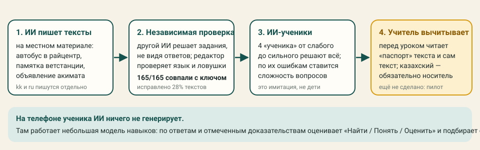

**Прототип: https://izden.vercel.app**

# Ізден — «сначала докажи, потом ответь»

Тренажёр чтения для 7–9 классов на казахском и русском, который работает без интернета. Ученик читает расписание автобуса, памятку ветстанции, объявление акимата или статью и **сначала нажимает в тексте место, где, по его мнению, ответ**, а потом выбирает вариант. Так видно, понял он или угадал. При ошибке Ізден называет ловушку, в которую ученик попал, и даёт подсказку. Учитель собирает результаты класса через QR-код с телефонов учеников, тоже без интернета, и получает готовый приём на завтрашний урок.

Кейс 3 Órleu Hack 2026 «Образование: читать и понимать». Сайт открывается один раз (около 0,9 МБ), дальше работает в режиме полёта; сервер не нужен.

## Демо

- **Сайт:** https://izden.vercel.app (учитель: вкладка «Учитель», кнопка «Демо-класс»)
- **Питч-видео (1:59):** [`submission/pitch.mp4`](submission/pitch.mp4)
- **Презентация (10 слайдов):** [`submission/slides.pdf`](submission/slides.pdf)
- **Описание для жюри:** [`submission/DESCRIPTION.md`](submission/DESCRIPTION.md)

## Проблема

- В PISA-2025 базового уровня 2 по чтению достигли только **36%** казахстанских 15-летних (в среднем по ОЭСР — 69%); средний балл **385 против 461** ([OECD, PISA 2025 Country Note: Kazakhstan](https://www.oecd.org/en/publications/pisa-2025-results-volume-i-country-notes_2d4ff9ea-en/kazakhstan_c01ae9c9-en.html)). Двое из трёх не могут найти нужное в тексте средней сложности и сделать вывод.
- Чтение не растёт полтора десятилетия: **390 (2009) → 385 (2025)** (там же: «relatively stable since 2009»).
- В селе хуже всего: ниже уровня 2 по чтению **77,9%** сельских 15-летних против 60,2% городских; разрыв по чтению — **37 баллов**, вдвое больше 18 баллов по математике из кейса ([PISA-2022, национальный отчёт МП РК / «Талдау»](https://www.gov.kz/uploads/2024/6/6/db5f5cbdb39f580badf51016c1ec49bb_original.4134139.pdf)).
- Масштаб: ≈ **1,06 млн** учеников 7–9 классов; **67%** школ — в сёлах, **2 654** малокомплектные ([Бюро нацстатистики](https://stat.gov.kz/upload/iblock/c0b/3e4gwgje0a3oha9fzkyidv6vl0zmnefx/%D0%A1-09-%D0%93%20(%D1%80%D1%83%D1%81).pdf); [Нацдоклад 2025](https://taldau.edu.kz/storage/app/media/National%20report/2025/2025%20%D0%9D%D0%94_%D0%BA%D1%80%D0%B0%D1%82%D0%BA%D0%B0%D1%8F_RU.pdf)). Высокоскоростной интернет — в **81%** школ ([24.kz со ссылкой на МП РК](https://24.kz/amp/ru/news/obrazovanie-i-nauka/805904-99-5-kazakhstanskikh-shkol-podklyucheny-k-internetu)), 125 школ не подключены вовсе ([Kapital.kz, МЦРИАП](https://kapital.kz/tehnology/139614/v-kazahstane-125-shkol-ne-podklyucheny-k-internetu.html)) — онлайн-репетиторы с ИИ там работают нестабильно.
- Обычный тест с выбором ответа не отличает понимание от угадывания и не говорит учителю, **какую именно ошибку** делает класс.

Оговорка о данных: соблюдены ли для Казахстана стандарты выборки PISA 2025, нам подтвердить не удалось. В сводной таблице PISA 2025 Министерства образования Сингапура Казахстан стоит без звёздочки «стандарты выборки не выполнены» ([moe.gov.sg, PDF](https://www.moe.gov.sg/media/newsroom/news/press/2026/75db500e-ed2c-4b2a-8eef-74460c5c74af.pdf)), но в поисковой выдаче по страновой заметке ОЭСР встречается такая оговорка, а сама страница ОЭСР из нашей среды не открылась. Перед защитой сверить с Reader's Guide PISA 2025. Все источники — в [docs/EVIDENCE.md](docs/EVIDENCE.md).

## Почему метод должен помочь

- Обучение стратегиям понимания прочитанного даёт в среднем **+7 месяцев** прогресса за год, метапознание и саморегуляция — **+8** ([EEF: reading comprehension strategies](https://educationendowmentfoundation.org.uk/education-evidence/teaching-learning-toolkit/reading-comprehension-strategies), [metacognition](https://educationendowmentfoundation.org.uk/education-evidence/teaching-learning-toolkit/metacognition-and-self-regulation)). «Сначала найди доказательство» — это и есть такая стратегия плюс немедленная обратная связь.
- Официальный отчёт PISA-2022 (МП РК / «Талдау») рекомендует **целенаправленно обучать техникам понимания прочитанного**.
- Честно: в обычном классе по стандартизированным тестам эффект скромнее — **d ≈ 0,19** ([Okkinga et al., 2018](https://doi.org/10.1007/s10648-018-9445-7)). Поэтому мы не обещаем рост PISA, а меряем результат своим тестом до/после ([`docs/PILOT.md`](docs/PILOT.md)).

## Как это работает

| Кто | Что делает |
|---|---|
| Ученик | Читает короткие тексты из жизни аула и райцентра. На каждый вопрос: 1) нажимает доказательство в тексте, 2) выбирает ответ. Получает один из четырёх итогов (ниже), а при ошибке — название ловушки, подсказку по шагам и вторую попытку. Подсветить доказательство можно, но это отмечается как «с помощью». |
| Учитель | Сканирует QR с телефонов учеников (или вводит короткий код), видит по каждому навыку «Найти / Понять / Оценить», кто отвечает верно без доказательства и какие ловушки чаще всего ловят класс, — и открывает карточку «что делать завтра»: приём на 10 минут и мини-лист для печати. |
| Ученик без смартфона | Получает печатный лист из того же банка: тексты с пронумерованными предложениями, бланк ответов «буква + номер доказательства» и ключ для учителя. |

Четыре итога ответа — главный экран:

| | Доказательство верное | Доказательство неверное |
|---|---|---|
| **Ответ верный** | «Понял» | «Угадал? Докажи» — ученик ещё раз ищет место в тексте |
| **Ответ неверный** | «Нашёл, но вывел неверно» — показываем ловушку | «Не нашёл» — сначала подсказка-шаг, подсветка только по запросу |

Три режима работы:
1. **Дома** — на своём телефоне, без интернета, прогресс хранится на устройстве.
2. **В классе** — по заданию учителя. Приказ МП РК № 282-НҚ от 24.09.2026 запрещает телефоны на уроках, кроме учебных заданий по указанию педагога ([zakon.kz](https://www.zakon.kz/pravo/6533155-kogda-i-kak-ucheniki-shkol-mogut-ispolzovat-mobilnye-telefony-prinyaty-pravila.html)); Ізден используется именно так: учитель даёт задание, в конце урока собирает QR.
3. **На бумаге** — лист заданий, бланк ответов и ключ (раздел «Печать»).

## Демо за 90 секунд

Язык демо — казахский (русский — переключатель «Рус»).

1. Открыть https://izden.vercel.app, дождаться загрузки, включить режим полёта, обновить страницу — в шапке появится «Офлайн», приложение работает на сохранённых данных.
2. На первом экране выбрать «Қазақша», имя «Айгерім», 8 сынып → «Бастау». Первый текст — «Автобус кестесі».
3. Вопрос: успеть в райцентр до 15:00. Нажать строку рейса №107 и выбрать «№107» → «Тексеру». Итог: «Дәлелді таптың, бірақ қорытынды қате», ловушка «Кестенің басқа жолы немесе бағаны»: взято время отправления, а нужно прибытие (15:10). Подсказка-шаг, затем «Дәлелді көрсету» подсвечивает строки №105 и №107. Выбрать №105 → «Дұрыс, екінші әрекеттен · көмекпен».
4. Вопрос 2: нажать любое предложение не о рейсах и выбрать верный ответ → «Жауап дұрыс, бірақ дәлел басқа жерде» → нажать нужную строку → «Енді дәлелденді!». Полосы навыков вверху меняются после каждого ответа (до первого ответа — «—»).
5. Закончить текст → «Келесі мәтін»: плашка «Неге осы мәтін?» объясняет, что текст выбран под самый слабый навык. «Тапсырма туралы» показывает, как текст сделан и проверен.
6. «Прогресс» → QR-код. Второй телефон: «Мұғалім» → «Камерамен сканерлеу» (или фото, или код) → строка Айгерім. «Демо-сынып қосу» добавляет 8 вымышленных учеников (помечены «демо») → главная ловушка класса → «Ертең не істеу керек» → приём и мини-лист.
7. «Басып шығару»: лист на слабый навык класса + бланк ответов + ключ.

## Где ИИ



1. **ИИ пишет тексты на местном материале.** Казахские и русские тексты пишутся отдельно, не переводом. 36 текстов, 165 вопросов, у каждого неверного варианта — тип ловушки и объяснение.
2. **Независимая проверка.** Другой ИИ решает все задания, не видя ответов (варианты перемешаны): **165 из 165** совпали с ключом. Отдельный ИИ-редактор проверяет язык и методику: на входе исправления потребовали 10 из 36 текстов (28%). Затем независимое ревью нашло подсказки по форме вариантов (верный ответ выделялся длиной) и вопросы «оценить», которые на деле были поиском по таблице, — это исправлено и теперь проверяется автоматически: ни одна «угадывающая» стратегия по длине вариантов не находит ключ чаще 35% случаев (случайный выбор — 25–33%).
3. **ИИ-ученики калибруют сложность.** Четыре ИИ-«ученика» от слабого до сильного решают весь банк. По их ошибкам выставлена сложность каждого вопроса и настроена модель навыков. Точность «учеников»: на казахском 52 / 68 / 87 / 100%, на русском 30 / 64 / 99 / 100% (симуляция на ИИ-учениках, не дети), — проверка на детях запланирована ([`docs/PILOT.md`](docs/PILOT.md)).
4. **Учитель вычитывает.** У каждого текста «паспорт»: как он сделан и проверен. Казахские тексты помечены «вычитано ИИ, нужна вычитка носителем».
5. **Без интернета на телефоне ИИ ничего не генерирует.** Там работает небольшая модель навыков (Bayesian Knowledge Tracing — адаптивная модель, не генеративный ИИ): по ответам и отмеченным доказательствам она оценивает три навыка и подбирает следующий текст. Все объяснения заранее проверены.
6. **С интернетом — ИИ-помощник, который не говорит ответ.** Кнопка «Спросить ИИ-помощника» появляется только после первого ответа на вопрос, поэтому диагноз «понял / угадал» всегда честный. Ученик пишет свой вопрос или жмёт готовый («Не понимаю вопрос», «Где искать в тексте?», «Почему мой ответ неверный?»). Помощник отвечает на казахском или русском и наводит на нужное место текста; после завершения вопроса может объяснить решение. Ключ хранится на сервере: страница обращается к нашей функции [`api/ask.js`](api/ask.js), а та — к бесплатной модели через OpenRouter (Baidu ERNIE 5.5 Flash, запасные — Gemma 4 31B и Nemotron 3 Ultra). Каждый ответ до завершения вопроса проверяется: если в нём есть верный вариант или его уникальные слова и числа, ответ заменяется шагом подсказки из банка. Нет сети, ключа или модель недоступна — тоже шаг подсказки из банка с пометкой. Ответ, полученный с ИИ-помощником, засчитывается «с помощью». Проверки — `node tests/test_ask.js`.


## Метрики

| Что | Значение | Где проверить |
|---|---|---|
| Банк | 18 текстов на казахском + 18 на русском, 165 вопросов; найти / понять / оценить: kk 26/35/23, ru 24/33/24 | `scripts/check.py` |
| Тексты из жизни села / не сплошной текст (таблицы, объявления, диаграммы) | kk 83% / 83%, ru 72% / 78% | [`evals/bank_report.md`](evals/bank_report.md) |
| Слепое решение итогового банка | 165/165 совпали с ключом | `evals/pipeline/solved/*_final.score.json` |
| Угадывание по длине вариантов: лучшая стратегия находит ключ | kk 34%, ru 30% (порог 35%) | `scripts/option_stats.py` |
| Модель навыков на 500 синтетических учениках (симуляция, не дети): ошибка оценки после 24 / 40 вопросов | адаптивный подбор 0,12 / 0,04 против фиксированного порядка 0,15 / 0,07 | [`evals/bkt_report.md`](evals/bkt_report.md) |
| Освоено навыков после 40 вопросов (симуляция, не дети) | 95% при адаптивном подборе против 87% при фиксированном | [`evals/bkt_report.md`](evals/bkt_report.md) |

Симуляция — **проверка, что модель работает как задумано**, а не доказательство пользы для детей: синтетические ученики ведут себя по той же модели. На коротком отрезке (8–16 вопросов) адаптивный подбор не лучше фиксированного. Польза для детей проверяется пилотом ([`docs/PILOT.md`](docs/PILOT.md)).

## Польза и масштаб

- **Экономика школы:** **0 ₸** за сервер, **0 МБ** трафика после первого открытия. Урок 45 минут без телефона у каждого ученика: бумажный лист + один телефон учителя.
- **Охват:** ≈ 1,06 млн учеников 7–9 классов, 67% школ в сёлах (цифры и источники — в «Проблеме» выше).
- <sub>Себестоимость нового текста — оценка ≈ $0,25–1,5, подробнее в [`docs/TECH.md`](docs/TECH.md).</sub>

## Что уже есть в школах и чем отличается Ізден

Только то, что удалось подтвердить по открытым источникам:

- **НИШ.** Открытого банка заданий по читательской грамотности на nis.edu.kz мы не нашли. Есть методические статьи учителей, например о диагностике читательской грамотности 9-классников по уровням PISA на уроках английского ([research.nis.edu.kz, PDF](https://research.nis.edu.kz/storage/images/2df9cacf-e71c-4e13-8aba-4645633b4dd9.pdf)).
- **Bilimland.** На главной странице есть раздел подготовки к ЕНТ с пунктами «Оқу сауаттылығы» и «Математикалық сауаттылық» ([bilimland.kz](https://bilimland.kz)). Приложение Bilim продаёт платные тарифы ([App Store](https://apps.apple.com/us/app/id1601509880)). Офлайн-режим в описании не упоминается.
- **Kundelik** — электронный журнал и дневник; ученикам обещаны «онлайн сабақтар мен тренажерлер» ([portal.kundelik.kz](https://portal.kundelik.kz/)). Тренажёров именно по читательской грамотности мы не нашли.
- **PISA в школах.** В 2025 году прошла «PISA для школ»: около 1000 школ и более 40 тысяч 15-летних, каждая школа получает свой отчёт, координатор — центр «Талдау» ([gov.kz](https://www.gov.kz/memleket/entities/control-aqmola/press/events/details/41349?lang=ru)).

Чем отличается Ізден:

| | Обычные тесты и сборники | Онлайн-репетиторы с ИИ | Ізден |
|---|---|---|---|
| Без интернета | бумага — да, онлайн — нет | нестабильно: нужен постоянный интернет | да, после одного открытия |
| Отличает понимание от угадывания | нет | частично | да: доказательство в тексте + четыре итога |
| Объясняет ошибку | общий ключ | да, но может ошибиться | тип ловушки + заранее проверенное объяснение |
| Картина класса для учителя | вручную | обычно нет | QR без сети → навыки, ловушки, приём на завтра |
| Тексты из жизни сельского Казахстана на kk и ru | редко | без проверки | 36 проверенных текстов |
| Стоимость на ученика | печать | подписка или токены | сайт без сервера |

## Бизнес-модель (гипотеза, не проверена)

- **Покупатель:** районный отдел образования или методкабинет — не школа и не ученик. Ученику и школе приложение бесплатно: сервера нет, платить за трафик и хостинг почти нечем.
- **«Пакет района»** (*гипотеза цены*: ≈ 100 тыс. ₸ в год за школу, для 20–30 школ — 2–3 млн ₸): доступ для N школ, печатные листы и бланки для классов без телефонов, обновление текстов в течение года (≈ 2 новых текста в неделю на язык и класс) и вычитка казахских текстов местными учителями.
- <sub>Себестоимость текста — оценка ≈ $0,25–1,5; год контента ≈ $100–600; главные расходы — вычитка и печать (не посчитаны). Расчёт: [`docs/TECH.md`](docs/TECH.md).</sub>
- **Путь:** 1 школа (пилот по [`docs/PILOT.md`](docs/PILOT.md)) → 10 школ района (районный методкабинет делится результатами с учителями-предметниками) → область (отдел образования области как закупка пакета для районов). Каждый шаг идёт только после результатов предыдущего; цифры цены и сроков — гипотезы для проверки в пилоте.

## Ограничения (честно)

- **Казахский:** тексты написаны и проверены ИИ, тексты 8 класса (путь демо) прошли дополнительную вычитку, но **нужна вычитка носителем** — это написано в паспорте каждого текста.
- Все проверки банка сделаны моделями одного семейства (Claude); они не ловят общие слепые зоны моделей — подсказки по форме вариантов нашло только независимое ревью. Нужна проверка учителями.
- ИИ-ученики — имитация; слабую персону играет более слабая модель, которая хуже знает и сам язык. В 63 из 165 вопросов ни одна персона не ошиблась — там неверные варианты слабые.
- **Пилота с детьми ещё не было**: все цифры об учениках — симуляция (ИИ-ученики, синтетические ученики). Протокол пилота — [`docs/PILOT.md`](docs/PILOT.md).
- Стартовые значения модели навыков (начальное владение и скорость обучения) заданы вручную; на реальных ответах модель не обучалась. Пилот 26.11 даст первые данные.
- Приватность QR: в QR ученика — только инициалы и 2-символьная метка (например, «А.С.#K7»), без полного имени; полное имя остаётся только на устройстве ученика. Но это не анонимизация: класс, язык и результаты по навыкам в QR есть, а учитель по инициалам и метке узнаёт ученика. Короткий код вообще не содержит имени — учитель вводит его сам.
- Прогресс хранится на одном устройстве; очистка браузера его стирает (QR у учителя — способ сохранить). Если браузер запрещает хранение, приложение работает в памяти и предупреждает.
- Режим полёта проверен по коду и списку файлов; во встроенном браузере среды разработки офлайн-кэш заблокирован, поэтому его нужно проверить на телефоне.
- 18 текстов на язык хватит на несколько недель занятий, не на год.

## Использованные инструменты

- **Claude Code / Claude** (Anthropic): код, генерация и проверка банка (Claude Opus и Sonnet — генераторы, решатели, редакторы; Claude Haiku и Sonnet — ИИ-ученики).
- **jsQR** 1.4.0 (Apache-2.0) — распознавание QR; **qrcode-generator** 1.4.4 (MIT) — создание QR. Обе библиотеки лежат в проекте, без внешних запросов.
- Python 3.12 + Pillow — проверки, симуляция, иконки.

Запуск, проверки, архитектура и форматы данных — в [docs/TECH.md](docs/TECH.md). Отчёты: [банк](evals/bank_report.md), [ИИ-ученики](evals/ai_students_report.md), [модель навыков](evals/bkt_report.md), [пилот](docs/PILOT.md).

## Стек

HTML, CSS и JavaScript без фреймворков (PWA с service worker, работает офлайн), Python 3.12 для генерации и проверки банка заданий и тестов. Хостинг — Vercel: статика плюс одна serverless-функция `api/ask.js` (Node 18+) для онлайн-помощника; модели — бесплатные через OpenRouter API. Без сети и без ключа всё остальное работает как раньше.

## Как запустить

```bash
git clone <адрес этого репозитория>
cd <папка>
python3 -m http.server 8000      # любой статический сервер
# открыть http://localhost:8000
```

Проверки: `python3 scripts/check.py` (банк заданий), `python3 tests/test_engine.py`, `python3 tests/test_text.py`, `python3 tests/test_qr.py` (движок, текст, QR), `node tests/test_ask.js` (ИИ-помощник не выдаёт ответ, работает без ключа). Подробнее — [docs/TECH.md](docs/TECH.md).

## Переменные окружения

Нужны только для онлайн-помощника (без них он отвечает шагами подсказки из банка): `OPENROUTER_API_KEY` — ключ OpenRouter, `AI_MODELS` — список моделей через запятую (необязательно), `AI_TIMEOUT_MS` — таймаут на модель (необязательно). На Vercel ключ задан в настройках проекта, в репозиторий не попадает. Локально функцию запускает `vercel dev`; обычный `python3 -m http.server` показывает всё, кроме помощника.

## Структура проекта

| Папка | Что там |
|---|---|
| `index.html`, `css/`, `js/`, `sw.js` | приложение (ученик, учитель, печать), офлайн-кэш |
| `api/ask.js` | онлайн ИИ-помощник: сервер с ключом, защита от подсказки ответа |
| `data/` | банк текстов и вопросов (kk, ru), параметры модели навыков, карточки ловушек |
| `scripts/` | сборка и проверка банка, паспорт заданий |
| `evals/` | отчёты: слепое решение, ИИ-ученики, модель навыков |
| `tests/` | тесты движка, QR и вёрстки учителя |
| `docs/` | кейс, SPEC, доказательная база, протокол пилота, тех. описание |
| `submission/` | видео, слайды, описание, шпаргалка для защиты |

## Команда

Команда **BLACKPILL DOTA 2 PRO** (ники на hackathon.kz):

- **Ibrakazah2** (@ibrakazah) — капитан
- **Temirlan2** (@temirlan-2)
- **lo1olo2** (@lo1olo)
- **adletseitenov2** (@adletseitenov)
