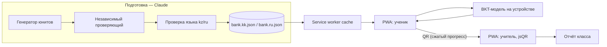

# Ізден: SPEC
**Кейс:** 3. Образование: читать и понимать. **Одной фразой:** офлайн-тренажёр читательской грамотности для 7–9 классов на казахском и русском. ИИ показывает ученику, где именно в тексте он ошибся и в какую ловушку попал, а учитель собирает результаты класса через QR-код без интернета.

## Plan-note
- **Идея:** приложение (PWA) один раз загружается целиком (до 2 МБ) и дальше работает в режиме полёта. Внутри банк коротких текстов в формате PISA из сельской и городской жизни (расписание автобуса, инструкция к лекарству для скота, объявление акимата, таблица урожая, прогноз погоды). Каждый вопрос привязан к одному из трёх процессов PISA: *найти*, *понять*, *оценить и поразмышлять*. Каждый неверный вариант размечен типом ловушки и предложением-доказательством. Адаптивная модель на устройстве (Bayesian Knowledge Tracing по трём навыкам) подбирает следующий текст. Учитель сканирует QR с телефона ученика и видит карту класса по навыкам.
- **Плюсы:** закрывает обе половины кейса (ИИ и слабый интернет); бьёт ровно в формулировку «найти информацию и сделать вывод»; работающий прототип, который можно открыть по ссылке; есть роль учителя.
- **Минусы и риски:** качество казахского языка в сгенерированном контенте; «ещё один тест» в глазах жюри; ИИ во время работы на устройстве — это не LLM, а адаптивная модель (честно объясняем).

## Проблема
- 36% казахстанских 15-летних достигают базового уровня 2 по чтению в PISA-2025 (контекст кейса). Двое из трёх не могут найти информацию в тексте средней сложности и сделать вывод.
- Разрыв город/село: 18 баллов по математике в PISA-2022 (кейс). В сельских школах слабый интернет, поэтому онлайн-ИИ-репетиторы там не работают.
- Учителю нечем быстро понять, какой именно навык проседает у класса.

## Решение (что видит пользователь)
- **Ученик:** выбирает язык (қаз/рус) и класс → получает текст → отвечает → при ошибке видит подсвеченное предложение-доказательство, название ловушки и подсказку-шаг → прогресс по трём навыкам («Табу/Найти», «Түсіну/Понять», «Бағалау/Оценить») и примерный уровень PISA.
- **Учитель:** режим «Сынып/Класс» → сканирует QR учеников камерой (офлайн) → тепловая карта класса: кто, какой навык, какие ловушки чаще всего → «Распечатать задания» для учеников без телефонов (печатный лист из того же банка).

## Демо-сценарий (90 секунд)
1. Открыть ссылку, включить режим полёта и обновить страницу: приложение работает.
2. Ученик Айгерим, 8 класс, казахский. Текст «Автобус кестесі» (таблица) и вопрос «Сағат 15:00-ден кейін ауданға қай автобус барады?».
3. Ответ неверный, и приложение подсвечивает строку таблицы: «Ловушка: ты взяла время отправления, а спрашивают про прибытие». Шаг-подсказка, ответ со второй попытки.
4. Ещё два вопроса. Адаптивный движок поднимает «Найти» и опускает «Оценить», следующий текст подобран под слабый навык (это видно на экране).
5. Экран «Мой прогресс», затем QR. Телефон учителя сканирует QR, и в отчёте класса появляется строка Айгерим. Отчёт класса: «60% класса попадают в ловушку "слово из текста ≠ ответ"».
6. Кнопка «Печать»: лист заданий для учеников без смартфона.

## Требования кейса → как закрываем
| Требование (цитата) | Решение | Статус |
|---|---|---|
| «с помощью ИИ» | (1) банк заданий сгенерирован и перекрёстно проверен LLM (генератор + независимый проверяющий + проверка языка); (2) BKT-модель знаний на устройстве; (3) диагностика ловушек | план |
| «функциональную грамотность (чтение или математика)» | Чтение; несплошные тексты (таблицы, графики, объявления) покрывают и «математическое чтение» | план |
| «ученикам 7–9 классов» | Сложность текстов по классам 7/8/9, контекст жизни подростка | план |
| «работало и в сельской школе со слабым интернетом» | PWA, service worker, всё кэшируется за одну загрузку ≤2 МБ; офлайн-синхронизация через QR; печатный режим | план |

## Скоуп
- **MUST:** PWA офлайн; банк ≥16 юнитов (текст + 3–5 вопросов) на **каждом** из двух языков, все прошли проверку; разметка каждого вопроса (процесс PISA, сложность, предложение-доказательство, ловушка и объяснение для каждого неверного варианта); экран вопроса с подсветкой доказательства; BKT-движок; экран прогресса; QR-экспорт и QR-сканер учителя (jsQR, локальный файл); отчёт класса; переключатель языка интерфейса; хранение в localStorage.
- **SHOULD:** печатный режим (print CSS); «шаги мысли» для сложных вопросов (подсказка в 2–3 шага); отчёт эвалов (качество банка, сходимость BKT на синтетических учениках) в `evals/`.
- **COULD:** онлайн-режим учителя «сгенерировать новый текст по теме» (если появится ключ); озвучка текста.
- **WON'T:** аккаунты, сервер, математика как отдельный трек, чат-бот.

## Архитектура

- Чистый HTML/CSS/JS без сборки, статический деплой на Vercel.
- `data/bank.<lang>.json`: схема в `docs/schema.md`.
- QR: прогресс ученика упаковывается в компактную строку (имя, класс, p(знает) по 3 навыкам, счётчики ловушек), ≤300 байт.

## AI-часть
- **Подготовка:** агенты Claude генерируют юниты по жёсткой схеме JSON; второй независимый агент решает каждый вопрос вслепую и сверяет с ключом (не совпало → в брак); третий проверяет язык и соответствие классу. В банк попадает только прошедшее проверку.
- **На устройстве:** BKT по навыкам (p_init, p_learn, p_slip, p_guess), выбор следующего вопроса по максимуму информации для самого слабого навыка; оценка уровня PISA по сумме (с пометкой «ориентировочно»).
- **Гардрейлы:** никаких открытых ответов, только выбор; все объяснения заранее проверены, ИИ на устройстве не может «выдумать» ответ.

## Как измеряем качество
- Банк: доля юнитов, прошедших слепое решение проверяющим (цель ≥90% после правок), доля вопросов с однозначным ответом, распределение по процессам PISA и классам.
- BKT: симуляция 500 синтетических учеников с известными навыками; ошибка оценки навыка после N вопросов против фиксированного порядка; сколько вопросов нужно до точности ±0,15.

## Стоимость и масштаб
- Около 1,2 млн учеников 7–9 классов в РК (*гипотеза, уточнить по stat.gov.kz*). Сервера нет: хостинг статики стоит почти 0 ₸, предельная стоимость ученика около 0. Генерация юнита Claude-ом стоит порядка центов, банк из 1 000 юнитов меньше $50.
- Один загруженный файл ≤2 МБ передаётся с телефона на телефон по Bluetooth или через QR-ссылку.

## Риски и план Б
- Казахский язык слабый → короткие тексты, проверка, пометка «вычитано ИИ, нужна вычитка учителем»; русский как основной язык в демо.
- Камера/jsQR не работает на устройстве жюри → ручной ввод кода (короткий код для копирования) как запасной путь.

## Роли и контрольные точки
- КТ-1 25.11 20:00: офлайн-PWA, 4 юнита, экран вопроса с подсветкой, BKT.
- КТ-2 26.11 14:00: полный банк, QR, отчёт учителя, деплой.
- КТ-3 26.11 22:00: эвалы, ревью, полировка. 27.11: презентация, видео, сдача до 20:00 (запас 3 часа).
